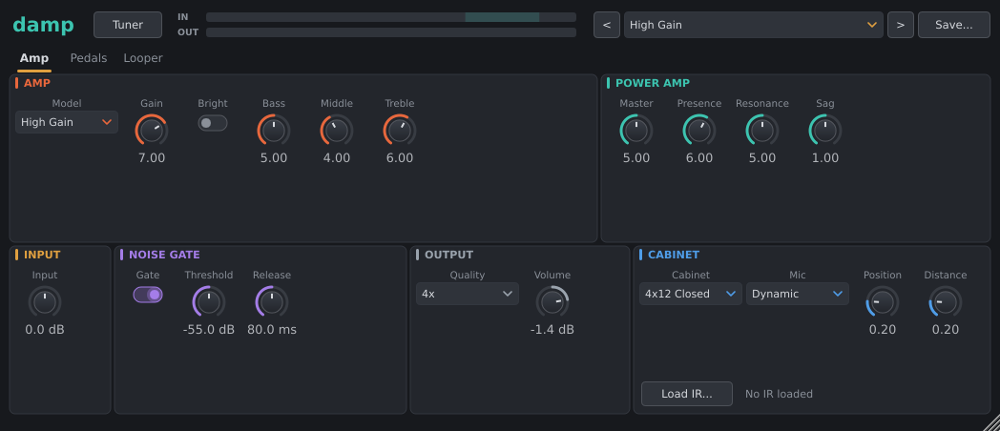
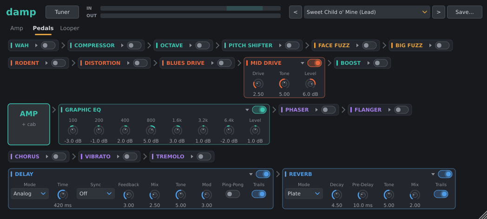
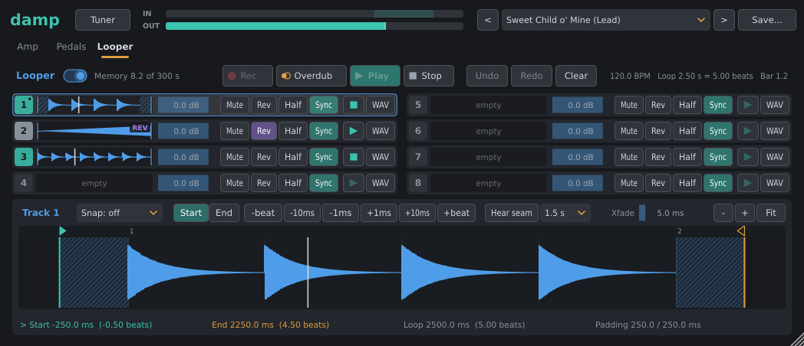

# damp

damp is a guitar amp simulator with a pedalboard, speaker cabinets (modelled or a loaded impulse
response), a chromatic tuner and an 8-track looper. The amp models are built from simulated
preamp tube stages, tone stacks and power sections rather than captured snapshots.

Supported bus layouts: mono in / mono out, mono in / stereo out, stereo in / stereo out. With a
mono input the amp and cab run once and the stereo pedals after the amp (chorus, delay, reverb
and so on) can spread the signal to stereo. A stereo input runs two amps keyed by one noise gate.

## Signal chain

```
input -> Input Gain -> Noise Gate -> [pedals before the amp] -> amp -> cabinet
      -> [pedals after the amp] -> looper -> Output Volume -> output
```

- Pedals before the amp and the amp itself run oversampled (see [Quality and latency](#quality-and-latency)).
- Pedals after the amp, the looper and the output volume run at the host rate.
- The looper is at the very end of the chain, so recorded loops keep their effects while you
  change sound over them. Output Volume affects loops and live signal alike.
- Host bypass passes the dry input, delayed by the plugin's latency so switching is seamless.

## Editor

- Header: title, **Tuner** button, input and output meters, preset bar.
- Tabs: **Amp**, **Pedals**, **Looper**.
- The window is resizable with a fixed aspect ratio (60% to 200%); the size is saved with the session.
- Controls that do nothing in the current setup are dimmed (gate controls with the gate off,
  Resonance on the Chime model, mic controls with no modelled cab).
- The input meter has a shaded range from -18 to -6 dBFS: set your interface (or Input Gain) so
  hard picking peaks inside it. The amp models are calibrated for that level.

## Amp tab



### Input, gate and output

| Control | Range (default) | Notes |
|---|---|---|
| Input | -24 to +24 dB (0) | Gain before the gate and everything else |
| Noise Gate | on/off (on) | |
| Threshold | -90 to -20 dBFS (-65) | Opens above this level |
| Release | 5 to 500 ms (80) | Fade to -60 dB once closed |
| Quality | 2x, 4x, 8x (4x) | Oversampling factor |
| Volume | -48 to +12 dB (0) | Output volume; -48 dB is silence |

The gate is a peak detector with 6 dB of hysteresis and a 40 ms hold, so a decaying note does
not chatter. It opens in well under a millisecond. It sits before every pedal, including a
compressor placed first.

### Amp models

| Model | Character |
|---|---|
| Clean | In the style of a 1960s American "blackface" combo: tone stack straight after the first stage, two 6L6 power tubes with plenty of negative feedback. Loud and clean until the volume is well up. |
| Chime | In the style of a British top-boost combo: two gain stages, treble/bass network, cathode-biased EL84s with no negative feedback and a sagging tube rectifier. |
| Crunch | In the style of a classic British EL34 head: lean bass from a partly bypassed first stage, bright cap on the gain pot, a cold second stage that clips asymmetrically. Default model. |
| High Gain | Four cascaded stages with tight lows and tamed fizz, 6L6 power section with a solid-state rectifier (little sag) and a deep Resonance control. |
| Modern High Gain | In the style of an American rectifier-type high-gain head: hotter input, a deeper mid scoop, darker and smoother clipping than High Gain, deep feedback and a tube rectifier's sag for looser, fatter lows. |

### Amp controls

| Control | Range (default) | Notes |
|---|---|---|
| Model | see above (Crunch) | |
| Gain | 0-10 (5) | Preamp gain pot (audio taper) |
| Bright | on/off (off) | Bright cap across the gain pot: a strong treble lift at low gain, little at high gain |
| Bass, Middle, Treble | 0-10 (5) | Passive tone stack, with each model's own component values |
| Master | 0-10 (5) | Drive into the power amp |
| Presence | 0-10 (5) | Treble lift via the power amp's feedback loop; on Chime (no loop) it works as a treble cut |
| Resonance | 0-10 (3) | Bass lift via the power amp's feedback loop; inactive on Chime |
| Sag | 0-2 (1) | Power supply sag amount, relative to the model's own |

### Cabinet

| Control | Options / range (default) |
|---|---|
| Cabinet | Off, 1x12 Open, 2x12 Open, 4x12 Closed, User IR (4x12 Closed) |
| Mic | Dynamic, Ribbon, Condenser (Dynamic) |
| Position | 0-1, cone centre to edge (0.3) |
| Distance | 0-1, on the grille to a couple of feet back (0.2) |

- Modelled cabs include speaker resonance, open-back bass cancellation (open cabs), cone breakup,
  the mic's response and proximity effect, and room reflections. Moving the mic towards the
  edge or further back darkens the sound; distance reduces the proximity bass boost.
- Mic, Position and Distance apply to modelled cabs only.
- All cabs and IRs are levelled to the same loudness (100 Hz to 5 kHz average), so switching
  does not jump in volume. Changes crossfade.

**Loading an impulse response.** Click **Load IR** under the cabinet controls and pick a WAV,
AIFF or FLAC file. The cabinet switches to User IR.

- Only the first channel is used; the IR is cut to 0.5 s, resampled to the host rate and levelled.
- The IR's samples are stored in the plugin state (inside the host project), so projects stay
  portable without the original file. The IR name is shown next to the button.
- User IR with nothing loaded passes the signal through, as does Off.

## Pedals tab



The pedalboard shows one tile per pedal plus an **AMP + cab** tile, in signal order, left to
right, wrapping onto rows.

- Each tile has an on switch. A pedal that is off folds down to its title strip; click its name
  to show or hide the controls.
- **Reordering:** drag a tile by its title and drop it where it should go. The order (including
  which side of the amp each pedal is on) is saved with the session and in presets.
- Placement limits: clipping pedals and the octave stay before the amp (they rely on the
  oversampled section); delay and reverb stay after it. A drop that breaks this is refused.
- Switching a pedal on or off crossfades over 10 ms. Delay and reverb instead stop taking input
  and either ring out (Trails on) or fade their wet signal out.
- Default order: Wah, Compressor, Octave, Pitch Shifter, Face Fuzz, Big Fuzz, Rodent, Distortion,
  Blues Drive, Mid Drive, Boost, **amp**, Graphic EQ, Phaser, Flanger, Chorus, Vibrato, Tremolo,
  Delay, Reverb.

| Pedal | Placement | Controls (range, default) | Character |
|---|---|---|---|
| Boost | before amp | Gain 0-20 dB (10), Tone 0-10 (5) | Clean transistor boost with a tilt tone around 800 Hz |
| Mid Drive | before amp | Drive, Tone 0-10 (5); Level -24..+12 dB (0) | Classic mid-hump overdrive: soft clipping of the band above ~720 Hz, clean signal alongside |
| Blues Drive | before amp | Gain, Tone 0-10 (5); Level -24..+12 dB (0) | Two discrete stages, asymmetric clipping, wide response, treble-shelf tone |
| Distortion | before amp | Dist, Tone 0-10 (5); Level -24..+12 dB (0) | Hard clipping (diodes to ground); tone crossfades low-pass and high-pass, scooped at noon |
| Rodent | before amp | Distortion 0-10 (5), Filter 0-10 (4); Level -24..+12 dB (0) | High-gain op-amp distortion that darkens as gain rises, variable low-pass filter |
| Face Fuzz | before amp | Fuzz 0-10 (7); Level -24..+12 dB (0) | Two-transistor fuzz; heavy settings sputter and gate on the decay |
| Big Fuzz | before amp | Sustain 0-10 (6), Tone 0-10 (5); Level -24..+12 dB (0) | Two cascaded soft-clipping stages and a mid-scoop tone control |
| Compressor | either | Sustain, Attack 0-10 (5); Blend 0-10 (10); Level -24..+12 dB (0) | OTA-style compressor; slow attack keeps the pick attack; Blend mixes dry back in (parallel) |
| Wah | either | Mode Pedal/Auto (Pedal); Pedal, Sensitivity, Response, Peak 0-10 (5) | Inductor wah sweeping ~350 Hz (heel) to 2.2 kHz (toe). Auto: playing harder pushes the sweep up from the Pedal position |
| Octave | before amp | Direct 0-10 (7), Oct 1 0-10 (7), Oct 2 0-10 (0) | Monophonic analog-style octave down: one and two octaves below. Chords confuse it, as on the original circuit type |
| Chorus | either | Rate 0.05-10 Hz (0.8), Depth 0-10 (5), Mix 0-10 (5), Width 0-10 (7) | Bucket-brigade style chorus; Width offsets the right LFO by up to half a cycle |
| Flanger | either | Rate 0.02-5 Hz (0.3), Depth 0-10 (6), Manual 0-10 (5), Regen 0-10 (5) | Sweep of up to 15 ms around Manual, with regeneration |
| Phaser | either | Rate 0.05-10 Hz (0.5), Depth 0-10 (10), Feedback 0-10 (3), Stages 4/6/8/12 (4) | Swept allpass stages mixed 50/50 with dry |
| Tremolo | either | Rate 0.5-15 Hz (5), Depth 0-10 (6), Shape (Opto), Pan on/off (off) | Shapes: Sine, Triangle, Square, Opto (photocell), Harmonic (lows and highs pulse in opposite phase). Pan makes it an auto-pan in stereo |
| Vibrato | either | Rate 0.2-12 Hz (5), Depth 0-10 (4), Mode Vibrato/Vibe (Vibrato) | Wet only. Vibrato: pure pitch modulation. Vibe: photocell-driven allpass throb |
| Delay | after amp | Mode Digital/Analog/Tape (Analog), Time 20-2000 ms (380), Sync (Off), Feedback 0-10 (4), Mix 0-10 (3), Tone 0-10 (5), Mod 0-10 (3), Ping-Pong (off), Trails (on) | See below |
| Reverb | after amp | Mode Spring/Plate/Hall (Spring), Decay 0-10 (5), Pre-Delay 0-200 ms (10), Tone 0-10 (5), Mix 0-10 (3), Trails (on) | See below |
| Pitch Shifter | either | Mode Steps/Free (Steps), Shift -24..+24 st (+12), Pedal 0-10 (10), Mix 0-10 (10) | Expression-pedal style shifter: the shift is Shift times the Pedal position |
| Graphic EQ | either | 100, 200, 400, 800, 1.6k, 3.2k, 6.4k Hz bands and Level, each -15..+15 dB (0) | Seven octave-spaced constant-Q bands. Placed after the amp by default (like an effects loop) |

Drive pedal Level knobs are set so 0 dB at default settings is close to the bypassed loudness.

**Delay modes**

- Digital: clean repeats, gentle high-cut (Tone); time changes crossfade without pitch bends.
- Analog: bucket-brigade band limit that darkens with longer times, soft saturation in the
  feedback loop, slow wobble (Mod); time changes glide in pitch.
- Tape: tape saturation, low-mid head bump, heavy high loss per repeat, wow and flutter (Mod).
- Sync sets the time from the host tempo: 1/2, 1/4., 1/4, 1/4T, 1/8., 1/8, 1/8T, 1/16 (Off uses Time).
- Ping-Pong (stereo outputs) alternates repeats left and right.
- The dry signal always passes at unity; repeats are added.

**Reverb modes**

- Spring: three-spring tank with the characteristic "drip" chirp; loud picking splashes.
- Plate: dense and bright from the start, no discrete echoes.
- Hall: early reflections, then a slow, diffuse build-up and smooth tail.
- The dry signal always passes at unity. A mode change fades the wet out and back in.

**Pitch Shifter modes**

- Steps: Shift and Pedal move in whole semitones, each step gliding over ~15 ms.
- Free: continuous, for detune, bends and dive bombs. Map Pedal to an expression controller
  through the host for whammy-style sweeps.
- Range two octaves either way. Expect a few milliseconds of delay on the shifted signal
  (more for chords shifted down).

## Quality and latency

- **Quality** (2x, 4x, 8x, default 4x) sets the oversampling of the amp and the pedals before it.
  Higher factors reduce aliasing from clipping at the cost of CPU.
- The plugin reports a fixed latency of **40 samples** at the host rate at every Quality setting,
  so changing it never changes the latency the host compensates.

## Tuner

- Click **Tuner** in the header to open it over the current tab; click again to close.
- Chromatic. It reads the plugin's input (before Input Gain and the gate). Shows the note name
  and octave, a -50 to +50 cent needle, and the reading in cents and Hz. The note and needle change
  colour within 3 cents.
- **Mute output while tuning** (on by default) silences the output while the tuner is open.
- **A4 =** sets the reference pitch, 415 to 466 Hz (default 440).
- Both settings are saved with the session.

## Looper

Eight stereo tracks at the end of the chain. Every track with audio plays at once. Each track
records the live signal (amp, cab and all pedals) without the loops already playing.



### Memory and switching on

- Turn on the **Looper** switch to reserve memory: 5 minutes of stereo at the host rate, shared
  by all tracks and undo. The header shows "Memory x of 300 s".
- When memory runs out, redo and then the oldest undo levels are given up first; after that the
  recording stops as if Rec had been pressed and a "Memory full" warning appears.
- Switching the looper off stops all tracks; their audio is kept.

### Transport

| Button | Action |
|---|---|
| Rec | On an empty selected track: start recording. Press again to close the loop and play it. |
| Overdub | On a track with a loop: overdub over it (a stopped track starts playing). Press again to stop overdubbing. Punches in and out over 5 ms. |
| Play / Stop | Play every track from the top of the first track's loop, or stop every track. |
| Undo / Redo | Selected track's last recording or overdub (up to 4 levels each way). Undo while recording discards the take. |
| Clear | Empty the selected track (Undo brings it back). |

- Click a track row to select it. Only one track records or overdubs at a time: pressing Rec on
  another track closes the current recording or overdub.
- Each row has: state badge (number in the state's colour; a dot marks the master track), a strip
  of the loop with its playhead, Level (-48 to +6 dB), **Mute**, **Rev** (reverse), **Half**
  (half speed: an octave down, twice as long), **Sync**, a per-track play/stop button and a
  **WAV** menu.
- Reverse and Half are playback only; a track cannot be overdubbed while either is on.
- Undo, Redo and Clear dip the track briefly and swap at silence; edits and switch changes crossfade.

### Sync and closing at the bar

- The first track recorded becomes the **master**. Its loop length sets the grid for the others.
- **Sync** (default on): the track locks to the master. Its length is rounded to a whole multiple
  of the master length, and it stays aligned however it is edited.
- Sync off (free): the track loops its own length on its own counter.
- Closing a sync recording waits for the next master-loop boundary, so the loop has no gap or
  cut. While it waits the badge blinks and the strip reads "ENDING AT BAR". Pressing Rec within
  50 ms (or a quarter of the master length, if shorter) after a boundary closes at that boundary
  at once.
- Anything else that ends the recording (Stop, Play/Stop, Rec on another track, Clear, Undo,
  switching the looper off, memory full) cancels the wait and closes at once, rounded to the
  nearest multiple; Clear and Undo discard the take.
- The master track and free tracks close as soon as Rec is pressed.
- Editing the master's length changes the grid; every sync track follows. Clearing the master
  keeps its length for the other tracks; clearing the last track resets it.

### Tempo

- The looper does not follow the host transport; Rec and Play start when pressed.
- The host tempo (120 BPM when the host provides none) is used for display and editing only:
  the header shows tempo, master loop length in seconds and beats, and the playing position as
  bar.beat (4/4). Snapping and beat nudges in the editor use it too.

### Waveform editor

The lower part of the tab edits the selected track. Edits are non-destructive and available once
a track has stopped recording.

- **Start / End handles:** drag to set the loop. Dragging past the recording adds padding:
  silence before or after (hatched, costs no memory). Readouts show start, end, loop length (ms
  and beats) and padding before / after.
- **Navigation:** mouse wheel zooms, drag away from a handle to scroll, double-click (or **Fit**)
  shows everything; **+** and **-** zoom around the handle being nudged. Deep zoom draws
  individual samples.
- **Nudges:** **Start** / **End** pick the handle (clicking a handle picks it too); buttons move
  it by a beat, 10 ms or 1 ms either way.
- **Snap:** off, zero (nearest zero crossing within 5 ms when the handle is released), beat or
  bar (host tempo; the start snaps to beats counted from the recording's first frame, the end to
  whole beats or bars after the start).
- **Xfade:** seam crossfade from the loop's end into its start, 0 to 50 ms (default 5). The
  recording's own edges fade over the same length.
- **Click to seek:** a click on the waveform (here or in a track row's strip) plays the track
  from that point; a stopped track starts playing. Seeking a sync track moves the shared clock,
  so all sync tracks jump together; a free track jumps alone. Seeking is ignored while it would
  disturb a recording or overdub.
- **Hear seam:** plays from shortly before the end handle so you can hear the end run into the
  start. The pre-roll menu sets how far back: 0.5, 1, 1.5 or 2 s (at most half the loop).
- **Overdubbing into padding:** an overdub over padded silence records into it; the take grows
  to cover what was written inside the loop.

### Import and export

The **WAV** menu on each row:

- **Export the recording...**: the whole take as recorded.
- **Export one loop as heard...**: one cycle with edits, padding, seam, reverse and half speed applied.
- **Import a WAV...**: WAV, AIFF or FLAC; resampled to the host rate and cut to what fits in
  memory. Edits reset and the track's history is cleared. A sync track starts on the master's
  loop start.
- Exports are 32-bit float stereo WAV at the host rate.

### Saving loops

- Loops are saved in the plugin state, inside the host project or session. There is no separate
  file or folder.
- Audio is stored losslessly as FLAC (24-bit, scaled per track so nothing clips), along with each
  track's edits and the master length. Undo history is not saved.
- After loading, tracks come back stopped. If the host sample rate changes, loops are resampled
  (undo history is dropped).
- Presets never save or load looper settings or audio.

### Host automation

The looper's controls are host parameters, so they can be mapped to footswitches or MIDI
through the host: Looper On, Selected Track, Rec / Overdub, Play / Stop All, Undo, Redo, Clear
Track, and each track's Level, Mute, Reverse, Half Speed and Sync. The button parameters act
when they go from off to on, so a footswitch fires once per press. Rec / Overdub cycles the
selected track: empty, record, play, overdub, play, overdub...

## Presets

The preset bar has a menu, previous / next arrows and **Save**.

### Factory presets

Grouped by category in the menu (file-name prefixes keep them in order):

| Category | |
|---|---|
| Clean, Edge of Breakup, Crunch, Lead, High Gain | General-purpose sounds across the amp models |
| '70s Songs, '80s Songs | Sounds inspired by well-known recordings of those decades |
| Ambient & FX | Effects-led sounds (octave, shimmer, surf spring and similar) |
| Metallica, Nu-Metal, CKY | Sounds inspired by recordings of those artists and that genre |

Song presets are interpretations inspired by the original recordings, not reproductions of
them; results depend on your guitar, pickups and playing.

### User presets

- **Save** writes a `.damp` file to the user preset folder and lists it under **User** in the menu.
- Folder (JUCE user application data directory + `damp/presets`):
  - Linux: `~/.config/damp/presets`
  - macOS: `~/Library/damp/presets`
  - Windows: `%APPDATA%\damp\presets`
- Copy `.damp` files into that folder to add them; they appear in the menu when it is next built
  (reopen the editor).

### File format

Plain text, one `id = value` per line. `#` starts a comment.

```
# damp preset
name = My Sound
category = Crunch
board = wah, compressor, octave, pitch, face_fuzz, big_fuzz, rodent, distortion, blues_drive, mid_drive, boost, amp, eq, phaser, flanger, chorus, vibrato, tremolo, delay, reverb
model = Crunch
gain = 6.5
bright = on
cab = 4x12 Closed
delay_on = on
delay_sync = 1/8.
```

- `name` and `category` (optional) label the preset; `board` is the pedal order (`amp` marks the
  amp's place). Pedals missing from `board` are placed as in the default order; pedals on the
  wrong side of the amp are moved across.
- Parameter ids are the lower-case ids from the parameter list (`gain`, `delay_time`,
  `tremolo_shape`, ...). Numbers are clamped to their range; switches take `on`/`off`
  (also `true`/`false`, `1`/`0`); choices take their name as shown in the editor (or index).
- Any parameter not listed takes its default value, so a preset only needs what differs.
- Unknown ids and bad values are skipped.
- Saved presets list every parameter except the looper's.

## Saved with the session

Parameters, pedal order, the loaded IR, tuner mute and reference pitch, window size, and the
looper's audio and edits.
