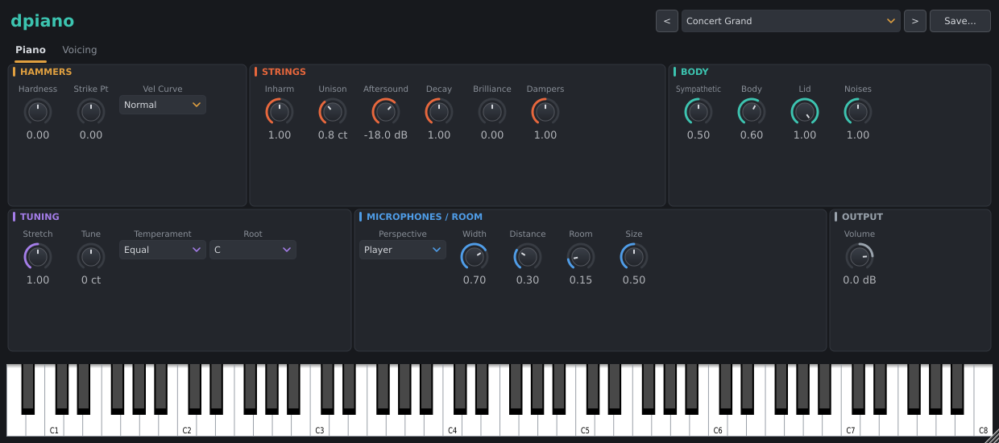

# dpiano

dpiano is a physically modelled grand piano. Every sound is computed while you play: no samples
are used or shipped. All 88 keys (A0 to C8, MIDI notes 21 to 108) are modelled individually and
can ring at once. Output is stereo (a mono output bus is also accepted and gets a mono mix).

## The model

- **Strings.** Each key's strings are a bank of resonant modes. Partial *n* sits at
  *n f0 sqrt(1 + B n^2)*, where *B* is the string's inharmonicity, and each partial decays at its
  own frequency-dependent rate. The unison strings fold into a fast "prompt" component and
  slightly detuned, slower "aftersound" components, giving the beating and two-stage decay of a
  real piano. Stringing follows a concert grand: single strings in the low bass, bichords in the
  bass, trichords above.
- **Hammers.** Each hammer is a mass on nonlinear, hysteretic felt (*F = K x^p*), coupled both
  ways to the strings and computed at 4x the sample rate while in contact. Harder strikes give
  shorter contact and a brighter tone; there are no velocity layers. Hammers are lighter and
  harder towards the treble.
- **Key data.** String mass and tension, *B*, hammer mass and felt, strike point, decay times and
  damper times for each key are interpolated from published measurements of grand pianos.
- **Dampers.** Each key has a damper; the top one and a half octaves have none, as on a real
  grand. Bass dampers stop the heavier strings more slowly.
- **Stretch tuning.** Octaves are stretched as an aural tuner would set them: beatless on the 4:2
  partials (6:3 in the low bass), given each string's inharmonicity.
- **Soundboard and body.** The force on the bridge drives a soundboard model: 64 distinct
  low-frequency modes, each with its own left and right microphone gain, plus a dense diffuse
  network for the higher, overlapping modes, and a direct path panned by key along the bridge.
  The board radiates poorly in the deep bass and rolls off in the high treble.
- **Sympathetic resonance.** Every undamped string is driven by the bridge, so open strings
  (pedal down, or held keys) pick up a halo from what is played.
- **Hammer knock.** The impact also reaches the board directly through bridge and frame: barely
  audible in the bass, a large part of the attack at the top.
- **Mechanical noises.** Synthesised keybed thump (velocity dependent), damper noise when a
  ringing key is released, and a pedal thump plus string stir when the sustain pedal moves.

Restriking a ringing key hits the same moving strings; there is no voice stealing.

Default voicing was fitted, for analysis only, to recordings of a concert grand from the
University of Iowa Musical Instrument Samples (C2 to C8): partial balance at mf and ff, loudness
along the scale, early decay of fundamentals, attack build-up and the share of non-tonal knock.
None of those recordings are included with dpiano.

## Editor

The window has a preset bar at the top, two tabs (**Piano** and **Voicing**), and an 88-key
on-screen keyboard at the bottom. The computer keyboard plays notes (Z S X D C V ... starting at
middle C) once the on-screen keyboard has focus. The window is resizable with a fixed aspect
ratio. The window size is saved with the session; the open tab is remembered while the plugin
stays loaded.

Hammer, string and tuning settings reach a key the next time it is struck (silent keys are also
updated in the background). Body, microphone, room and volume settings apply at once.

### Piano tab



| Section | Controls |
|---|---|
| Hammers | Hammer Hardness, Strike Position, Velocity Curve (Soft, Normal, Hard) |
| Strings | Inharmonicity, Unison Detune (cents), Aftersound Level (dB), String Decay, Brilliance, Damper Strength |
| Body | Sympathetic Resonance, Soundboard Body, Lid Opening, Mechanical Noise |
| Tuning | Stretch Tuning, Master Tune (cents), Temperament, Temperament Root |
| Microphones / Room | Stereo Perspective, Stereo Width, Microphone Distance, Room Mix, Room Size |
| Output | Master Volume (-48 to +12 dB) |

- **Hammer Hardness**: softer to harder felt (-1 to 1).
- **Strike Position**: moves the strike point along the string (-1 to 1, about 0.66x to 1.5x of
  each key's natural point).
- **Velocity Curve**: how MIDI velocity maps to hammer speed.
- **Inharmonicity**: scales every string's *B* (0 to 2). Also changes the stretch tuning curve.
- **Unison Detune**: spread between a key's unison strings (0 to 6 cents). High values give a
  honky-tonk sound.
- **Aftersound Level**: level of the slow aftersound relative to the prompt sound.
- **String Decay**: scales all decay times (0.25x to 4x).
- **Brilliance**: less or more high-frequency loss in the strings.
- **Damper Strength**: how quickly dampers stop the strings (0.25x to 4x).
- **Sympathetic Resonance**: amount of string-to-string coupling through the bridge.
- **Soundboard Body**: how much the board's own modes and diffuse ring colour the sound.
- **Lid Opening**: closed (0) to fully open (1). A closed lid takes about 10 dB off the treble.
- **Mechanical Noise**: level of keybed, damper and pedal noises (0 to 2x).

## Tuning

- **Stretch Tuning** scales the stretched tuning curve: 0 is unstretched, 1 is the normal aural
  stretch, 2 is double.
- **Master Tune**: +/-100 cents. A4 = 440 Hz at 0.
- **Temperament**: Equal, Just (5-limit), Pythagorean, 1/4-Comma Meantone, Werckmeister III,
  Kirnberger III, Vallotti.
- **Temperament Root**: C to B; the key the temperament is built on. A4 stays at its reference
  pitch whatever the temperament and root.

## Pedals (MIDI)

| CC | Pedal | Behaviour |
|---|---|---|
| 64 | Sustain | Continuous. Dampers begin to lift at about a quarter of the travel and are fully clear at three quarters, so intermediate values give half-pedalling (dampers only lightly touching the strings). |
| 66 | Sostenuto | On at 64 and above. Holds up the dampers that are raised when it is pressed: the keys held at that moment, or all of them if the sustain pedal is fully down. |
| 67 | Soft (una corda) | On at 64 and above. The hammer misses one string of each unison and strikes softer felt: less prompt sound, relatively more aftersound, a softer tone. |

All Notes Off and All Sound Off release held keys and all pedals. Pitch bend and other
controllers are ignored.

## Output

- **Stereo Perspective**: **Player** puts the bass on the left (as heard from the bench);
  **Audience** puts the bass on the right.
- **Stereo Width**: how far keys spread across the stereo field (0 to 1).
- **Microphone Distance**: close (0) to far (1). Further away trades direct sound for more of the
  board's body and loses some treble.
- **Room Mix** and **Room Size**: a built-in room reverb; size sets the room size, decay (0.5 to 3 s) and
  pre-delay.
- **Master Volume**: -48 to +12 dB.

## Voicing tab

The model's physical constants. The defaults are the fitted values; adjust them by ear.

| Section | Control | Effect |
|---|---|---|
| Hammer Voicing | Treble Hammer Hardness | Extra felt hardness that grows from middle C to the top key |
| | Felt Nonlinearity | Felt curve: how much brighter loud notes get, keeping a typical mf tone |
| | Dynamic Range | Range from softest to loudest velocity (12 to 40 dB, default 28) |
| | Hammer Knock | Level of the non-tonal impact sent into the board (0 to 3x) |
| Soundboard Response | Soundboard Bloom | How much sound builds up through the board's slower resonances rather than the direct path |
| | Soundboard Energy Drain | How fast the board draws energy from mid-range fundamentals (the fast early decay around middle C) |
| | Bass Radiation Cutoff | High-pass corner of the board's radiation (30 to 300 Hz, default 160) |
| | Warmth (Board Mobility) | How far the direct sound drops by 2 kHz (0 to 24 dB, default 14) |
| | Air (Treble Roll-off) | Corner of the high-frequency roll-off (2 to 20 kHz, default 6 kHz) |

## Presets

The preset bar has previous/next buttons, a menu and **Save**. Factory presets are grouped by
category:

| Category | Presets |
|---|---|
| Grands | Concert Grand, Studio Grand, Jazz Club, Concert Hall (Audience) |
| '70s Songs | Bohemian Rhapsody (Ballad Grand), Bennie and the Jets (Rock Grand), Let It Be (Gospel Grand), Imagine (Soft and Close) |
| '80s Songs | Don't Stop Believin' (Bright Grand), Hello (Ballad Grand), Africa (Pop Grand) |
| Character | Felt Piano, Honky-Tonk, Werckmeister III (Historical), Resonant Grand |

Song presets are piano sounds inspired by the piano on the named recordings. They are settings
of this model, not samples or reproductions of those recordings.

### File format

Presets are plain text files with the `.dpiano` extension:

```
# dpiano preset
name = Jazz Club
category = Grands
hammer_hardness = -0.35
lid = 0.6
temperament = Equal
```

- One `id = value` per line; `#` starts a comment.
- Parameters not listed take their default values.
- Numbers outside a parameter's range are clamped. Choices are written by name (case
  insensitive) or by index.
- `category` is optional; files saved from the plugin have none.
- Factory files are named `<category number>_<index>_<name>.dpiano` (00 Grands, 10 '70s Songs,
  20 '80s Songs, 30 Character) so they sort into menu order.

### User presets

**Save** writes the current settings to a `.dpiano` file. Presets in the user folder appear in a
**User** section at the end of the menu, sorted by file name. The folder is
`dpiano/presets` inside JUCE's user application data directory:

| OS | Folder |
|---|---|
| Linux | `~/.config/dpiano/presets` |
| macOS | `~/Library/dpiano/presets` |
| Windows | `%APPDATA%\dpiano\presets` |

Preset files can be copied into this folder by hand; the list is read when the editor opens.

## Session state

The host session stores every parameter plus the editor size. Saving a loaded session again
gives identical data.

## CPU

An 88-key fortissimo glissando held on the sustain pedal uses about 17% of one CPU core in a
Release build. Keys that have fallen silent stop being processed.
