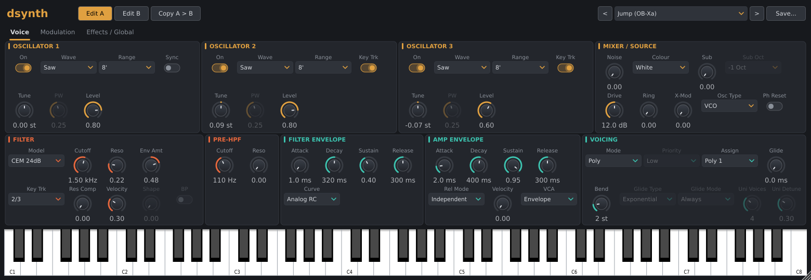
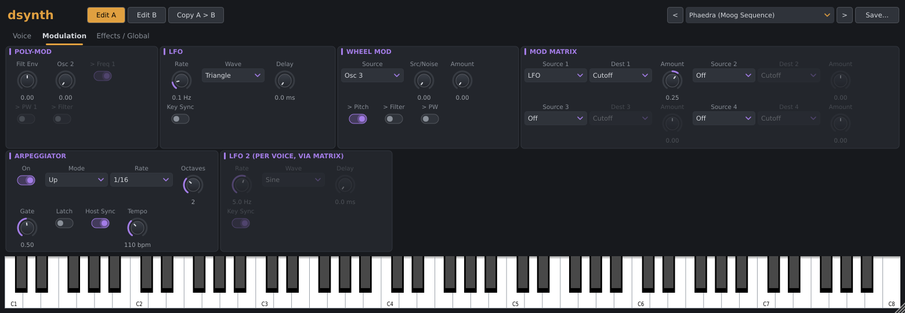

# dsynth

dsynth is an analog-modelling polyphonic synthesizer (VST3, CLAP, LV2 and Standalone). Rather than
emulating one instrument, it offers one configurable voice: oscillator character, filter model,
envelope curve, voice allocation and so on are selectable, and presets combine them to set up a
particular style of instrument.

- 8 voices per layer, two layers (A and B).
- Mono or stereo output.
- Each voice runs at 2x the host sample rate, or 4x in HQ mode.

## Signal flow

Per voice:

```
Osc 1 / Osc 2 / Osc 3 + Sub + Noise + Ring mod
  -> Pre-HPF (resonant high-pass) -> Mixer drive -> Filter -> VCA -> pan
```

Per layer (all voices summed):

```
High-pass (Juno-style) -> downsample to host rate -> Chorus -> Delay -> Reverb -> Master volume
```

Layer A and layer B each have their own full chain, including effects, LFO and arpeggiator. Their
outputs are mixed by the layer balance.

## Editor

The top bar has these controls, from left to right:

- **Edit A / Edit B**: choose which layer the panel and host automation control.
- **Copy A > B / Copy B > A**: copy the layer being edited to the other layer.
- **Preset menu**: with previous / next buttons, and **Save**.

There is an on-screen keyboard (C1 to C8) at the bottom. It can also be played from the computer
keyboard (Z S X D C V G B H N J M ..., starting at middle C).

The editor can be resized between 60% and 200%. The size is saved with the session. Controls that
have no effect on the current patch are dimmed but stay adjustable. For example, PW is dimmed
unless the wave contains a pulse, and the unison controls are dimmed outside Unison mode.

The controls are spread over three tabs: **Voice**, **Modulation** and **Effects / Global**.

## Voice tab



### Oscillators 1, 2, 3

| Control | Notes |
|---|---|
| On | Enables the oscillator in the mixer. Osc 2 and Osc 3 still run as modulation sources when they are off. |
| Wave | Sine, Triangle, Saw, Ramp, Square, Pulse, Saw+Pulse, Saw+Tri, Tri+Pulse |
| Range | Lo, 32', 16', 8', 4', 2'. Lo is 7 octaves below 8', for LFO-rate use. |
| Tune | ±7 semitones |
| PW | Pulse width. Only active for waves that contain a pulse. |
| Level | Mixer level |
| Sync (Osc 1) | Hard-syncs Osc 1 to Osc 2. |
| Key Trk (Osc 2, 3) | When off, the oscillator ignores the keyboard and stays at a fixed pitch. Pitch bend and matrix Pitch still apply. |

### Mixer / Source

- **Noise**: level, with **Colour** White or Pink.
- **Sub**: square-wave sub-oscillator that follows Osc 1, with **Sub Oct** -1 Oct or -2 Oct.
- **Drive**: 0 to 24 dB into the filter.
- **Ring**: level of Osc 1 x Osc 2.
- **X-Mod**: linear cross-modulation of Osc 1 frequency by Osc 2.
- **Osc Type**:
  - VCO: oscillators drift and carry tuning tolerance.
  - DCO: stable pitch. The filter and envelopes still vary.
- **Ph Reset**: oscillators restart at the same phase when a note starts from silence, so every
  attack is identical.

### Filter

- **Model**:

| Model | Character |
|---|---|
| Ladder 24dB / Ladder 12dB | Transistor ladder |
| CEM 24dB | OTA cascade |
| IR3109 24dB / IR3109 12dB | OTA cascade |
| SEM 12dB | State-variable. The Shape control sweeps LP > Notch > HP, and BP selects bandpass. |
| MS-20 12dB | Korg35-style low-pass |
| ARP 24dB | ARP-style ladder |

  Every model except SEM can self-oscillate.

- **Cutoff** and **Reso**.
- **Env Amt**: bipolar, ±7 octaves.
- **Key Trk**: Off, 1/3, 2/3 or Full.
- **Res Comp**: restores the passband level that drops as resonance rises. Not available on SEM or MS-20.
- **Velocity**: velocity to cutoff, up to 3 octaves.

### Pre-HPF

A resonant high-pass on each voice, before the filter, with **Cutoff** and **Reso**. At the minimum
cutoff (10 Hz) it is effectively off.

### Filter Envelope and Amp Envelope

- ADSR on each. Times range from 1 ms to 10 s.
- **Curve** (shared by both envelopes): Analog RC (exponential segments) or Linear.
- **Rel Mode**: Independent, or Use Decay. Use Decay replaces both release times with the decay
  time.
- **Velocity** (Amp Envelope): velocity to level.
- **VCA**:
  - Envelope: the amp envelope shapes the level.
  - Gate: on/off with a short declick, for organ sounds. The amp ADSR is ignored.

### Voicing

- **Mode**: see [Voice modes](#voice-modes).
- **Priority**: Last, Low or High. Used in Mono, Legato and Unison.
- **Assign**: see [Poly key assign](#poly-key-assign). Used in Poly only.
- **Glide**: time, up to 5 s.
  - **Glide Type**: Exponential or Linear.
  - **Glide Mode**: Always, or Legato Only.
- **Bend**: pitch-bend range, 0 to 12 semitones.
- **Uni Voices** (2 to 8) and **Uni Detune** (up to ±30 cents spread).

## Voice modes

| Mode | Behaviour |
|---|---|
| Mono | One voice. Every new key retriggers the envelopes. |
| Legato | One voice. Envelopes retrigger only when playing from silence. |
| Poly | Up to 8 voices. |
| Unison | 2 to 8 voices stacked on one note and detuned. The level is scaled so the stack adds thickness rather than volume. |
| Duo | Two-note paraphony: Osc 1 plays the lowest held key and Osc 2 plays the highest. |

In Mono, Legato and Unison, returning to a key that is still held never retriggers the envelopes.
In Poly, glide in Legato Only mode applies while other keys are held.

### Poly key assign

- **Poly 1**: uses the voice that has been silent longest, so release tails ring on.
- **Poly 2**: always reuses the lowest-numbered released voice, which cuts its release short.
- **Rotate**: cycles through voices in turn. Repeated notes move across voices with different
  component tolerances.

## Modulation tab



### Poly-Mod

Two sources: **Filt Env** (bipolar) and **Osc 2**.

Destinations, which can be combined:

- **> Freq 1**: Osc 1 frequency.
- **> PW 1**: Osc 1 pulse width.
- **> Filter**: cutoff. Osc 2 modulates the cutoff at audio rate.

### LFO

One LFO per layer, shared by all of that layer's voices.

- **Rate**: 0.05 to 50 Hz.
- **Wave**: Triangle, Saw, Ramp, Square, Sine or S&H.
- **Delay**: fade-in time, restarted for each new note.
- **Key Sync**: restarts the LFO when a key is pressed with no other keys held.

### LFO 2 (per voice)

- Each voice has its own LFO 2, with the same wave choices as the LFO plus **Rate**, **Delay** and
  **Key Sync** (on by default).
- It only reaches the sound through the mod matrix: use it as a matrix source.
- Without key sync, each voice runs at its own phase.

### Wheel Mod

- **Source**: Osc 3 or LFO. **Src/Noise** crossfades the source with noise.
- **Amount**: the panel amount plus the mod wheel (CC1).
- **Destinations**: **> Pitch** (up to 12 semitones), **> Filter** (up to 4 octaves) and
  **> PW**.

### Mod Matrix

Four slots, each with a **Source**, a **Dest** and a bipolar **Amount**.

- **Sources**: Off, LFO, Filter Env, Amp Env, Osc 3, Velocity, Key, Mod Wheel, Aftertouch, Noise,
  Timbre (CC74), LFO 2.
  - Key is centred on C4 (MIDI note 60).
  - Aftertouch is the highest of channel pressure, poly pressure and MPE pressure.
- **Destinations**: Pitch, Osc 1 Pitch, Osc 2 Pitch, Osc 3 Pitch, Osc 1 PW, Osc 2 PW, Cutoff,
  Resonance, Osc 1 Level, Osc 2 Level, Noise Level, Amp.
- **Full-scale depth**:
  - Pitch destinations: ±24 semitones, on a squared curve that makes small amounts finer.
  - Cutoff: ±6 octaves.

### Arpeggiator

- **On**: turning it on or off releases the notes that are sounding.
- **Mode**:
  - Up and Down.
  - Up & Down: the top and bottom notes are not repeated.
  - Random: avoids repeating the same note immediately.
  - As Played: keeps the order the keys were pressed in.
- **Rate**: 1/4, 1/8, 1/8 T, 1/16, 1/16 T or 1/32.
- **Octaves**: 1 to 4.
- **Gate**: note length as a fraction of a step. Full gate plays legato.
- **Latch**:
  - The pattern keeps playing after the keys are released.
  - The next key pressed after all keys were released starts a new pattern.
  - Turning latch off with no keys held stops the pattern.
- **Host Sync**: follows the host tempo. While the host transport plays, steps lock to the host's
  beat grid.
- **Tempo** (40 to 240 bpm): used when Host Sync is off or the host has no tempo.

Each note keeps the velocity it was played with. Each layer has its own arpeggiator.

## Effects / Global tab

### Chorus / HPF

- **Chorus**: Off, I, II or I + II. A BBD-style stereo chorus.
- **HPF**: a non-resonant high-pass after the voices.
  - Off.
  - Bass Boost: a low shelf.
  - 1, 2, 3: 225 Hz, 500 Hz and 1.1 kHz, 12 dB/oct.

### Delay

- **Mode**: Off, Stereo or Ping-Pong.
- **Sync**:
  - On: the time is set by **Note**: 1/32, 1/16 T, 1/16, 1/16 D, 1/8 T, 1/8, 1/8 D, 1/4 T,
    1/4, 1/4 D, 1/2 or 1/1. It follows the host tempo, or the arpeggiator Tempo when there is
    no host tempo.
  - Off: the time is set by **Time**, 1 to 2000 ms.
- **Feedback**, **Tone** (low-pass cutoff in the feedback path, so repeats darken) and **Mix**.

### Reverb

A feedback-delay-network reverb with **Mix**, **Size**, **Decay** (0.2 to 20 s), **Damping** and
**Pre-Delay** (0 to 200 ms). The reverb is bypassed while Mix is 0.

### Analog / Out

- **Drift**: slow, random wander of each voice's pitch and cutoff. Pitch does not drift in DCO
  mode.
- **Tolerance**: fixed differences between voices in oscillator tuning, cutoff and envelope
  times, like component spread in a real instrument. The differences are deterministic, so
  renders are repeatable.
- **Pan Spread**:
  - Poly: voices sit at fixed positions, alternating left and right.
  - Unison: the stack is spread across the stereo field.
- **Tune** (±100 cents) and **Volume** (-48 to +6 dB).

### Shared settings

The Layers, MPE, Keys / Tuning and Engine sections are marked "shared": they apply to the whole
instrument, not to the layer being edited.

- **Layers**: Mode, Split, A / B, B Detune. See [Layers](#layers-a-and-b).
- **MPE**: MPE on/off, and Note Bend range (1 to 96 semitones). See
  [Expression and MIDI](#expression-and-midi).
- **Keys / Tuning**:
  - **Vel Curve**: Linear, Soft, Hard, S-Curve or Fixed (always full velocity).
  - **Tuning**: Equal, Just (5-limit), Pythagorean, 1/4-Comma Meantone, Werckmeister III,
    Kirnberger III or Vallotti.
  - **Root**: the key the tuning is based on, C to B. Ignored for Equal.
- **Engine**: Quality Normal (2x) or HQ (4x). HQ reduces aliasing and costs about twice the voice
  CPU. Changing it releases the sounding notes.

## Layers (A and B)

| Layer Mode | Behaviour |
|---|---|
| Single | Only layer A plays. |
| Dual | Every note plays both layers. |
| Split | Notes below the **Split** point play layer B, and notes from the split point up play layer A. |

- **A / B** balances the two layers.
- **B Detune** offsets layer B by up to ±50 cents.
- Edit A / Edit B switch which layer the panel and host automation control. The other layer keeps
  its settings and keeps playing.
- Loading a preset selects Edit A.
- Sessions and presets store both layers.

## Expression and MIDI

| Input | Effect |
|---|---|
| Velocity | Shaped by Vel Curve. It goes to Amp Velocity, Filter Velocity and the Velocity matrix source. |
| Pitch bend | Bend range (master channel in MPE mode). |
| CC1 mod wheel | Adds to Wheel Mod Amount, and is also a matrix source. |
| Channel aftertouch, poly aftertouch | The Aftertouch matrix source. Each note uses the highest of the two. |
| CC74 | The Timbre matrix source. |
| CC64 | Sustain pedal. |
| All Notes Off / All Sound Off | Releases all notes. |

When **MPE** is on, MIDI channel 1 is the master channel and channels 2 to 16 carry per-note
expression:

- Pitch bend, scaled by the MPE Note Bend range.
- Pressure, which goes to the Aftertouch source.
- CC74, which goes to the Timbre source.

Host program changes select the factory presets.

## Presets

The preset menu groups the factory presets by category. Files saved by the user appear under a
**User** heading.

| Category | Contents |
|---|---|
| Basics | Init |
| '70s Songs, '80s Songs | Sounds inspired by well-known recordings |
| Bass | |
| Leads | |
| Brass | |
| Keys & Plucks | |
| Pads & Strings | |
| Bells & FX | |
| Sequences & Arps | |

Song presets are approximations of the synth parts on the original recordings. They are named
"Song (Synth)" or "Song (Part)", for example *Axel F (Jupiter-8 Lead)* or *Holiday (Bass)*.

### User presets

**Save** opens a file dialog in the user preset folder. The menu lists every `*.dsynth` file in
that folder.

| OS | Folder |
|---|---|
| Linux | `~/.config/dsynth/presets/` |
| macOS | `~/Library/dsynth/presets/` |
| Windows | `%APPDATA%\dsynth\presets\` |

### File format

Presets are plain text files, one setting per line:

```
# comment
name = Split Bass + Strings
category = Pads & Strings
layer_mode = Split
split_note = 48
osc1_wave = Saw+Pulse
mod_pitch = off
filter_model = IR3109 24dB

[layer b]
osc1_wave = Saw
osc1_range = 16'
```

- Each setting is an `id = value` line. The parameter ids come from the plugin's parameter table,
  for example `filter_cutoff` or `arp_mode`.
- Choices are written by name, as shown in the editor. On/off switches are written as `on` or
  `off`. Numbers are in the parameter's own unit (Hz, s, dB, semitones and so on).
- Parameters that are not listed take their default values.
- `name` sets the name shown in the menu. `category` places a factory preset under a menu heading.
- An optional `[layer b]` section holds layer B. Shared settings (layer mode, split, MPE, velocity
  curve, quality, tuning) always come from the top section.
- Saving writes every parameter. The `[layer b]` section is written only when Layer Mode is not
  Single.
- Lines with unknown ids or bad values are skipped.
- Factory preset files are named `NN_MM_name.dsynth`, where `NN` is the category number (00, 10,
  ..., 90) so the files sort in menu order.
